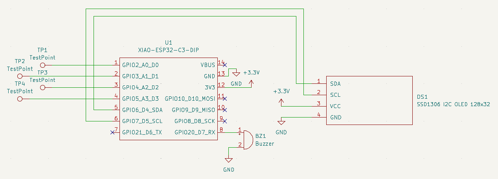
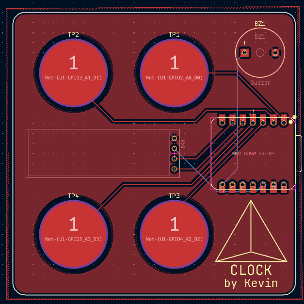

# Tetra Clock

A custom alarm clock loosely based on the Blare guide.

## Details
PCB made using **KiCAD** 
Firmware uses **CircuitPython**

This PCB is a simple alarm clock display I designed to show the date and time, and set alarms.

- **Microcontroller**: XIAO ESP32-S3
- **Display**: 0.91 inch 128x32 OLED display (SSD1306 driver)
- **Sound**: 3.3V Piezo Buzzer
- **Input**: Capacitive touchpads

**Features**:
- **ISO 8601 timestamp** datetime display
- Set **alarm time**
- **Alarm** enabled toggle
- **Snooze** enabled toggle

## About
When I saw [Mitxela's Precision Clock](https://mitxela.com/projects/precision_clock_mk_iv),
I was inspired to design a custom clock myself. I wanted mine to be much more compact, like
something you could carry around in a pocket, but that still looked cool and worked well.
I used capacitive pads because it's an easy way I've found to make button inputs that, one,
don't require any extra components, and two, are as compact as possible, being just as slim
as the board itself.

This project was originally made for week 1 (PCB week) of Hack Club's Half Life. The idea and some of
the components used were based on the [Blare guide](https://blare.hackclub.com/docs/getting-started),
but the actual design and the firmware was created from scratch by me.

## Setup
1. **Obtain hardware** - Buy the **components** and get the **PCB** fabricated ([gerber](/production/gerber/gerber.zip)).
2. **Solder parts** - Using pin headers where necessary, solder the **microcontroller**, **buzzer**, and **display** onto the board.
3. **Install CircuitPython** - Use the [CircuitPython guide for the XIAO ESP32C3](https://wiki.seeedstudio.com/xiao_esp32c3_with_circuitpython/) to install it onto the board.
4. **Upload firmware** - Use the same guide to upload [the firmware](/firmware/code.py) to the board.

## Images

### Schematic

### PCB

